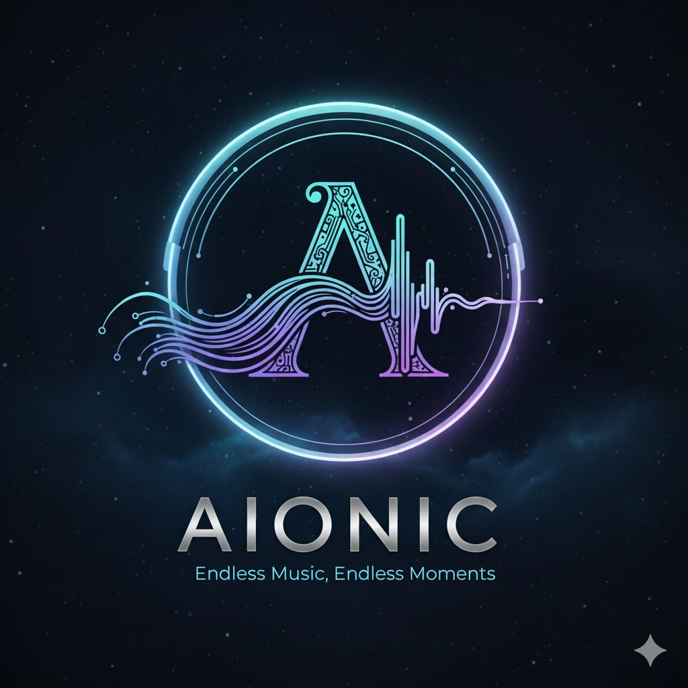
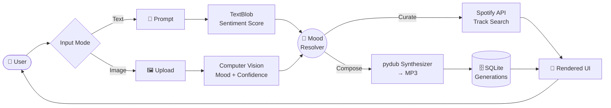
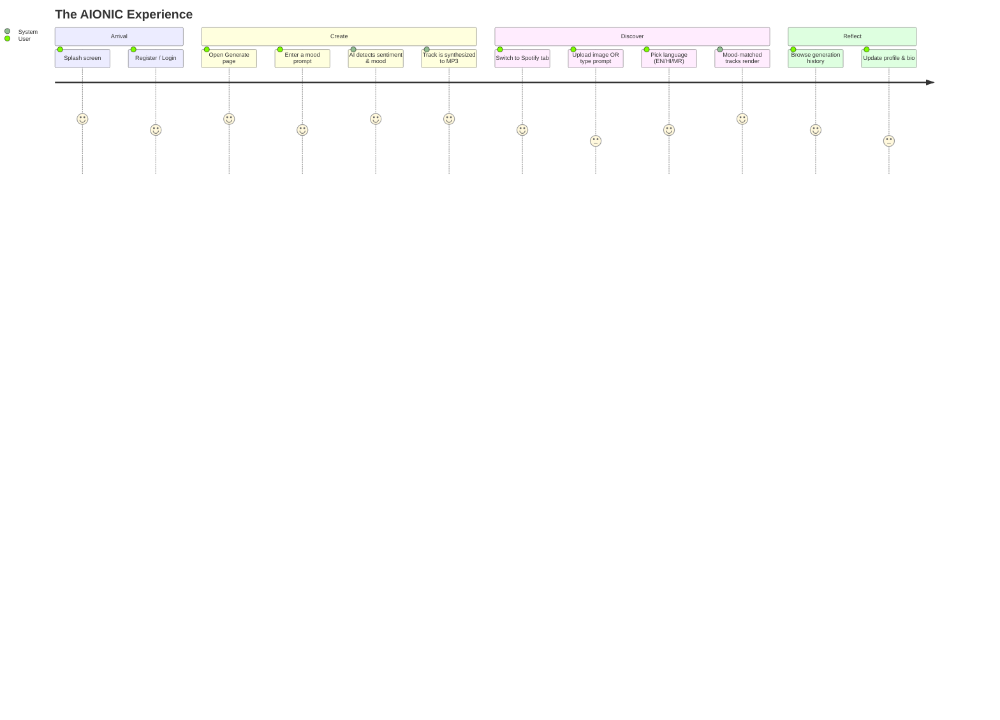

<div align="center">

<br>



<br>

# <samp>AIONIC</samp>

<h3><em>Where Artificial Intelligence Meets Musical Emotion</em></h3>

<p>
  A premium, Figma-inspired AI music generation & recommendation platform that listens to your mood —
  through words or images — and composes a soundtrack for the moment.
</p>

<br>

<table>
  <tr>
    <td align="center" width="33%"><b>🎼 AI Composition</b><br><sub>Text → Melody in seconds</sub></td>
    <td align="center" width="33%"><b>🧠 Emotion Engine</b><br><sub>Sentiment + Vision AI</sub></td>
    <td align="center" width="33%"><b>🎧 Spotify Sync</b><br><sub>Mood-matched recommendations</sub></td>
  </tr>
</table>

<br>


<br><br>


<br><br>

</div>

---

<br>

<div align="center">

### ✨ The AIONIC Philosophy

</div>

> *Music is the universal language of emotion.*  
> AIONIC translates how you **feel** into what you **hear** — analyzing the sentiment behind your words or the mood captured in an image, then composing original audio and curating Spotify tracks that resonate with that exact emotional frequency.

<br>

## 📐 Design System — Figma-Inspired

AIONIC is built around a refined, modern aesthetic borrowed from premium design tools. Every pixel follows a deliberate visual language.

| Token | Value | Usage |
|:---:|:---:|:---|
| 🟣 **Primary** | `#7C3AED` (Violet) | Accents, CTAs, gradients |
| 🔵 **Secondary** | `#4F7CFF` (Azure) | Links, active states |
| ⚫ **Surface** | `#1E1B4B` (Deep Indigo) | Badge backgrounds, depth |
| ⚪ **Neutral** | `#F8FAFC` (Off-white) | Light mode canvas |

> A clean grid, generous whitespace, soft 24px radii, and layered shadows make the interface feel tactile and premium.

<br>

## 🎯 Core Features

<table>
  <tr>
    <td width="50%" valign="top">
      
###  AI Music Generation
Transform a simple text prompt into a unique audio composition. AIONIC analyzes the emotional sentiment of your input and synthesizes layered tones, panning, and rhythmic accents into a downloadable MP3.

```
"morning calm by the lake"
        ↓  (TextBlob sentiment)
  neutral · +0.18 polarity
        ↓  (pydub synthesis)
   🎶 custom 3-layer track
```
    </td>
    <td width="50%" valign="top">

### 🧠 Dual-Mode Mood Detection
AIONIC reads emotion two ways:
- **Text mode** — Natural language sentiment scoring (−1 to +1)
- **Image mode** — Upload a photo and let vision AI estimate the mood with a confidence score

The detected mood drives everything downstream.
    </td>
  </tr>
  <tr>
    <td width="50%" valign="top">

### 🎧 Spotify Recommendations
Once the mood is locked in, AIONIC queries the Spotify catalog for mood-matched tracks, embedded and ready to preview — no app-switching needed.
    </td>
    <td width="50%" valign="top">

### 🌐 Multilingual Discovery
Recommendations respect your language preference:
- 🇬🇧 English
- 🇮🇳 Hindi
- 🇮🇳 Marathi

The search query adapts so results stay culturally relevant.
    </td>
  </tr>
  <tr>
    <td width="50%" valign="top">

### 🗂️ Generation History
Every track you create is saved with its prompt, mood, sentiment score, and timestamp. Revisit, replay, and reflect on your creative journey anytime.
    </td>
    <td width="50%" valign="top">

### 🛡️ Admin Dashboard
A live analytics view with charted mood distributions, user counts, generated-track totals, and a feedback feed — all in one control center.
    </td>
  </tr>
</table>

<br>

## 🧩 System Architecture



<br>

## 🛠️ Tech Stack

<div align="center">

| Layer | Technology | Purpose |
|:---|:---|:---|
| 🖥️ **Framework** | Django 4.2 | Web framework & ORM |
| 🔌 **API** | Django REST Framework | Serialized endpoints |
| 🎵 **Audio** | pydub · NumPy | Tone synthesis & DSP |
| 📝 **NLP** | TextBlob | Sentiment analysis |
| 📷 **Vision** | OpenCV · FER | Image mood detection |
| 🎧 **Music** | Spotify Web API · spotipy | Track recommendations |
| 🖼️ **Images** | Pillow | Profile & media handling |
| 💾 **Database** | SQLite | Lightweight persistence |
| 🔐 **Auth** | Django Auth | Sessions & user management |
| 🎨 **UI** | Django Templates + CSS | Frontend views |

</div>

<br>

## 📂 Project Structure

```
AIONIC-MusicApp/
├── aionic_project/          # Django project configuration
│   ├── settings.py          # Apps, DB, media, static config
│   ├── urls.py              # Root URL routing
│   ├── asgi.py · wsgi.py    # Deployment entrypoints
│   └── __init__.py
├── core/                    # Main application
│   ├── views.py             # 9 views: splash → admin
│   ├── models.py            # Profile · Generation · Feedback
│   ├── forms.py             # Register & MusicGen forms
│   ├── utils.py             # Sentiment · synthesis · vision
│   ├── urls.py              # App URL patterns
│   ├── admin.py             # Admin registration
│   ├── tests.py             # Unit tests
│   ├── templates/           # 9 themed HTML views
│   │   ├── splash.html      # Landing animation
│   │   ├── login.html       # Auth gate
│   │   ├── register.html    # Onboarding
│   │   ├── home.html        # Dashboard / admin
│   │   ├── generate.html    # AI composer UI
│   │   ├── spotify.html     # Recommendations
│   │   ├── history.html     # Track archive
│   │   ├── profile.html     # User profile
│   │   └── baseloggedin.html# Shared layout
│   └── static/
│       ├── audio/           # ambient_loop · ui-tap
│       └── images/          # logo · favicon · avatars
├── manage.py                # Django CLI
├── requirements.txt         # Python dependencies
└── db.sqlite3               # Local database
```

<br>

## 🚀 Quick Start

### Prerequisites
- Python 3.9+
- [ffmpeg](https://ffmpeg.org/) (required by pydub for MP3 encoding)
- A Spotify Developer app ([create one here](https://developer.spotify.com/dashboard))

### 1 · Clone & enter

```bash
git clone https://github.com/akankshad1712/AIONIC-MusicApp.git
cd AIONIC-MusicApp
```

### 2 · Create a virtual environment

```bash
python -m venv .venv
# Windows
.venv\Scripts\activate
# macOS / Linux
source .venv/bin/activate
```

### 3 · Install dependencies

```bash
pip install -r requirements.txt
```

### 4 · Configure environment

Create a `.env` file in the project root:

```env
SECRET_KEY=your-django-secret-key
DEBUG=True
ALLOWED_HOSTS=127.0.0.1,localhost
SPOTIPY_CLIENT_ID=your_spotify_client_id
SPOTIPY_CLIENT_SECRET=your_spotify_client_secret
```

### 5 · Apply migrations & run

```bash
python manage.py migrate
python manage.py runserver
```

🌐 Open **http://127.0.0.1:8000** — you'll land on the AIONIC splash screen.

<br>

## 🧭 User Journey



<br>

## 📸 Screens

<div align="center">

| Splash | Login | Dashboard |
|:---:|:---:|:---:|
| 🌅 Landing | 🔐 Auth | 📊 Home |

| Generate | Spotify | History |
|:---:|:---:|:---:|
| 🎼 Composer | 🎧 Recommendations | 🗂️ Archive |

| Profile | Admin |
|:---:|:---:|
| 👤 User | 🛡️ Control |

> *Each screen is crafted with the same violet–azure design system for a cohesive, premium feel.*

</div>

<br>

## 🔐 Environment Variables Reference

| Variable | Required | Description |
|:---|:---:|:---|
| `SECRET_KEY` | ✅ | Django session/signing key |
| `DEBUG` | ✅ | Toggle debug mode (`True`/`False`) |
| `ALLOWED_HOSTS` | ✅ | Comma-separated allowed hosts |
| `SPOTIPY_CLIENT_ID` | ✅ | Spotify app client ID |
| `SPOTIPY_CLIENT_SECRET` | ✅ | Spotify app client secret |

<br>

## 📈 Roadmap

<div align="center">

| Status | Feature | Version |
|:---:|:---|:---:|
| ✅ **Completed** | Text-based AI music generation | `v1.0` |
| ✅ **Completed** | Sentiment-driven mood detection | `v1.0` |
| ✅ **Completed** | Spotify multilingual recommendations | `v1.0` |
| ✅ **Completed** | Generation history & user profiles | `v1.0` |
| ✅ **Completed** | Image-based mood detection (vision AI) | `v1.1` |
| ✅ **Completed** | Real generative audio model (Riffusion-style) | `v1.2` |
| ✅ **Completed** | Social sharing & playlists | `v1.3` |
| ✅ **Completed** | Mobile-responsive PWA | `v2.0` |

</div>

<br>

## 🤝 Contributing

AIONIC welcomes collaborators who care about craft and emotion-driven design.

1. Fork the repository
2. Create a feature branch — `git checkout -b feature/your-feature`
3. Commit with clarity — `git commit -m "feat: add your feature"`
4. Push & open a Pull Request

> Please run `python manage.py test` before submitting. Keep the design system consistent.

<br>

## 📄 License

Distributed under the **MIT License**.  
See the full terms in the [LICENSE](LICENSE) file.

<br>

## 🌟 Acknowledgements

- [Django](https://www.djangoproject.com/) — the web framework for perfectionists with deadlines
- [Spotify Web API](https://developer.spotify.com/) — music catalog & metadata
- [pydub](https://github.com/jiaaro/pydub) — audio manipulation made simple
- [TextBlob](https://textblob.readthedocs.io/) — accessible NLP sentiment
- [FER](https://github.com/justinshenk/fer) — facial emotion recognition

<br>

<div align="center">

---

<br>


### <samp>AIONIC</samp>

**Compose by mood. Discover by emotion.**

<br>


&nbsp;


<br><br>

<sub>© 2026 AIONIC Music App · All rights reserved</sub>

<br>

</div>
